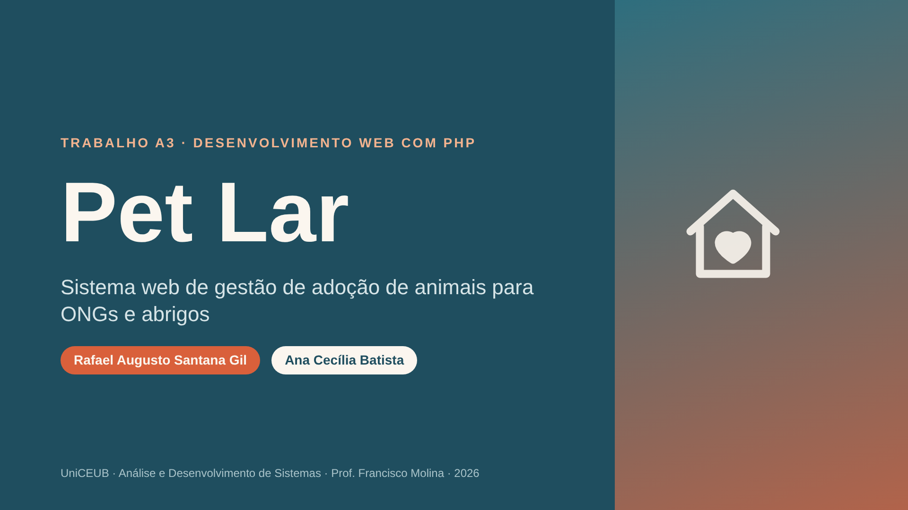
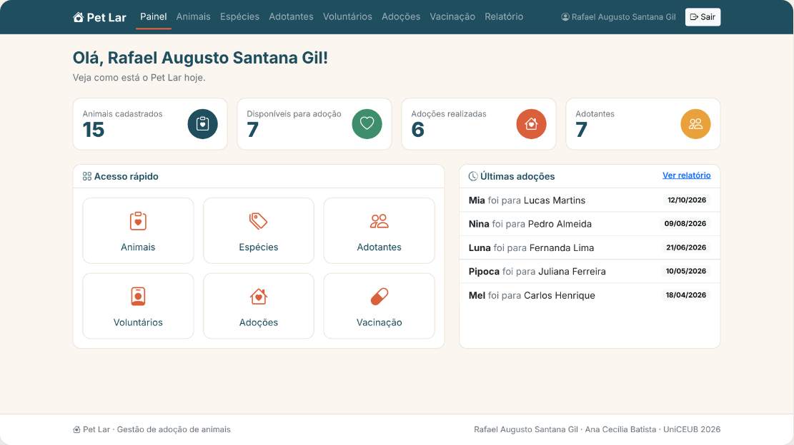
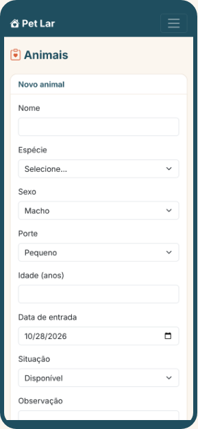
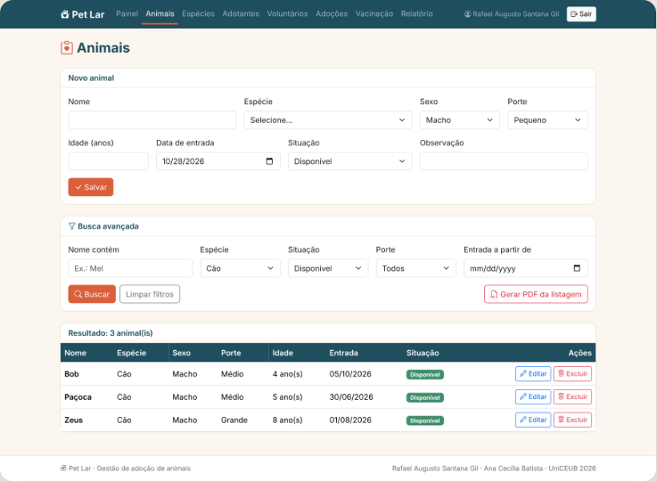
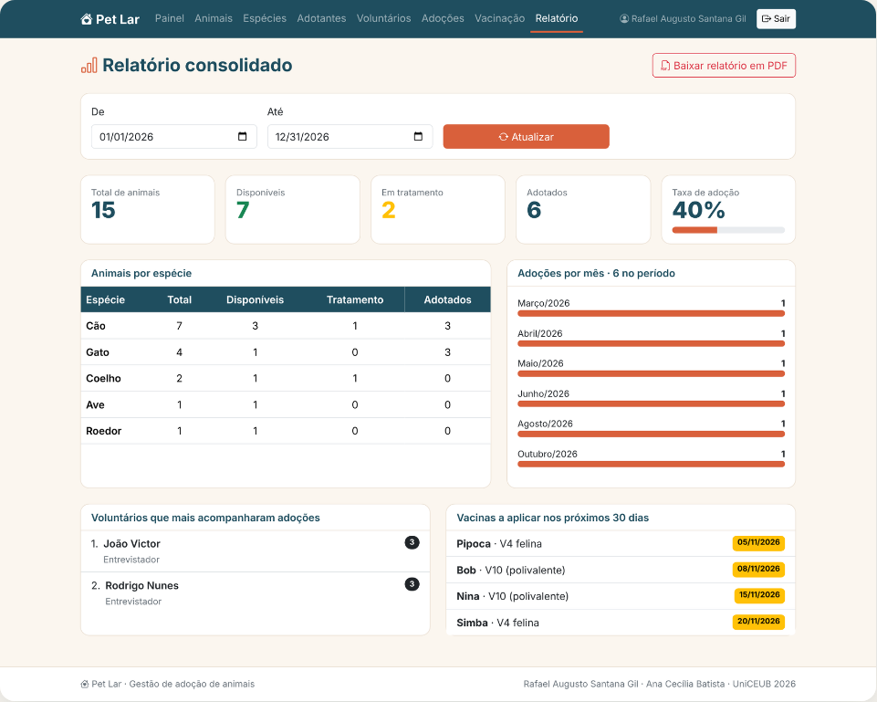
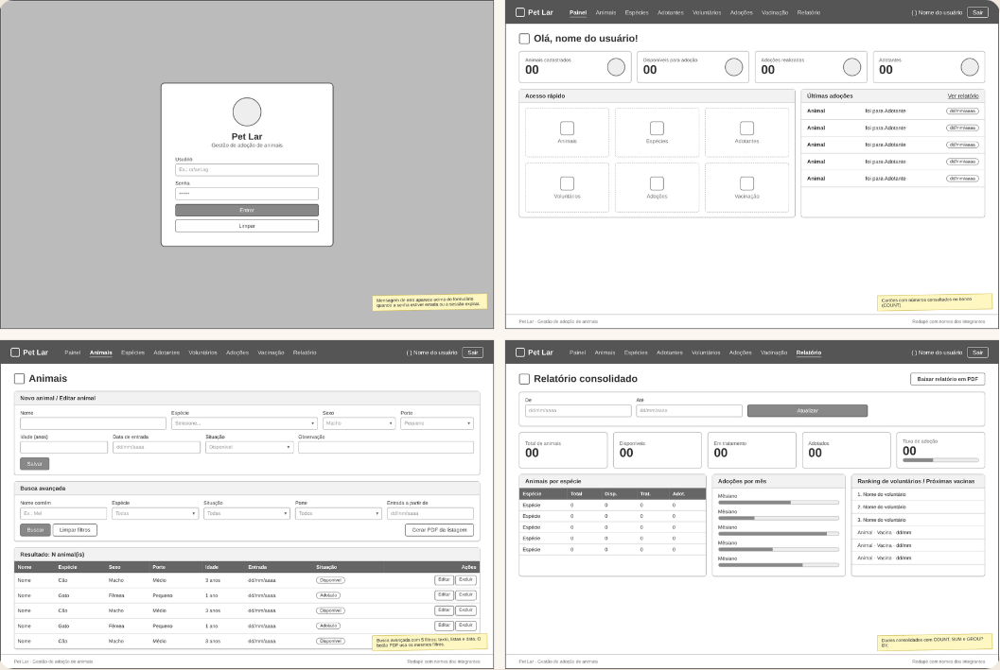
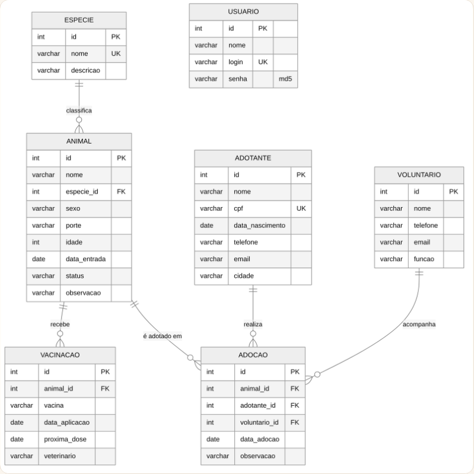

<div align="center">



# 🏠 Pet Lar

**Sistema web de gestão de adoção de animais para ONGs e abrigos**


Trabalho A3 · Desenvolvimento Web com PHP · **UniCEUB** · Prof. Francisco Molina · 2026

**Rafael Augusto Santana Gil** · **Ana Cecília Batista**

[Como rodar](#-como-rodar) ·
[Telas](#-telas) ·
[Estrutura](#-estrutura-de-pastas) ·
[Banco de dados](#-banco-de-dados) ·
[Regras de negócio](#-regras-de-negócio) ·
[Documentação](#-documentação-e-apresentação)

</div>

---

## 📌 O problema e a solução

Muitas ONGs ainda controlam as adoções em cadernos, planilhas soltas e grupos de mensagem. Os dados ficam espalhados, a próxima dose de vacina passa sem ninguém ver e não sobra histórico de para quem cada animal foi.

O **Pet Lar** junta tudo num só lugar: seis tipos de informação ligados entre si (espécie, animal, adotante, voluntário, adoção e vacinação), com login, busca avançada, relatório consolidado e PDFs.

## ✨ O que o sistema faz

| Exigência do Trabalho A3 | Onde está |
|---|---|
| ✅ CRUD completo em PHP | 6 módulos: `especie/`, `animal/`, `adotante/`, `voluntario/`, `adocao/`, `vacinacao/` |
| ✅ 6 tipos de informação relacionados | 6 tabelas ligadas por chave estrangeira (+ tabela `usuario`) |
| ✅ Autenticação com sessão | `login.php`, `verifica_login.php`, `sair.php` |
| ✅ Busca avançada com 3+ filtros | `animal/index.php` (5 filtros: nome, espécie, situação, porte e data de entrada) |
| ✅ Relatório consolidado | `relatorio/index.php` |
| ✅ Listagem em PDF | `pdf/animais.php` e `pdf/relatorio.php` |
| ✅ Script MySQL com carga inicial | `banco.sql` |
| ✅ Interface com Bootstrap | `cabecalho.php` (Bootstrap 5.3 via CDN) + `css/estilo.css` |

## 🚀 Como rodar

1. Instale o **XAMPP** (ou outro pacote com Apache, PHP 7.4+ e MySQL) e inicie **Apache** e **MySQL**.
2. Copie esta pasta para `C:\xampp\htdocs\petlar`.
3. No **MySQL Workbench** (ou phpMyAdmin), abra o `banco.sql` e execute tudo. O banco `petlar` é criado do zero, já com dados de exemplo.
4. Em `conexao.php`, ajuste `$user` e `$pass` com o usuário e a senha do seu MySQL (no XAMPP padrão: `root` e senha vazia).
5. Acesse **http://localhost/petlar/**.

**Usuários de teste** (senha de todos: `123456`):

| Usuário | Nome |
|---|---|
| `rafael.ag` | Rafael Augusto Santana Gil |
| `ana.cecilia` | Ana Cecília Batista |
| `admin` | Administrador |

> [!NOTE]
> O Bootstrap e os ícones vêm da internet (CDN). Sem conexão o sistema funciona, mas sem o visual. Os PDFs funcionam sem internet.

## 🖼️ Telas

<table>
<tr>
<td width="78%"><br/><sub><b>Painel</b>: números do abrigo, atalhos e últimas adoções</sub></td>
<td width="22%"><br/><sub><b>Celular</b>: o menu vira “hambúrguer”</sub></td>
</tr>
</table>

<table>
<tr>
<td width="50%"><br/><sub><b>Busca avançada</b> com 5 filtros e PDF da listagem</sub></td>
<td width="50%"><br/><sub><b>Relatório consolidado</b> com COUNT, SUM(CASE) e GROUP BY</sub></td>
</tr>
</table>

<details>
<summary><b>Protótipo de média fidelidade</b></summary>
<br/>

</details>

## 📁 Estrutura de pastas

```
PetLar/
├── banco.sql              script do banco (MySQL) com a carga inicial
├── conexao.php            conexão com o banco (PDO) → variável $pdo
├── index.php              tela de login
├── login.php              processa o login e cria a sessão
├── verifica_login.php     protege as páginas internas (sessão + tempo limite)
├── sair.php               logout (destrói a sessão)
├── cabecalho.php          topo das páginas: <head>, Bootstrap, menu, alertas
├── rodape.php             fim das páginas: rodapé e JavaScript do Bootstrap
├── painel.php             página inicial depois do login
├── css/estilo.css         cores e ajustes visuais
│
├── especie/               CRUD de espécies          ┐
├── animal/                CRUD + busca avançada     │  cada um com
├── adotante/              CRUD de adotantes         │  index.php   (lista + formulário)
├── voluntario/            CRUD de voluntários       │  inserir.php (INSERT ou UPDATE)
├── adocao/                CRUD de adoções           │  excluir.php (DELETE)
├── vacinacao/             CRUD de vacinas           ┘
│
├── relatorio/index.php    relatório consolidado
├── pdf/                   modelo_pdf.php, animais.php e relatorio.php
├── lib/fpdf/              biblioteca FPDF 1.86
│
├── docs/                  documentação, guia do código, roteiro e imagens
└── slides/                apresentação em PDF, PowerPoint e PNG
```

### Como uma página é montada

Toda página interna segue a mesma ordem:

```php
<?php
    $raiz = '../';
    include '../verifica_login.php';   // 1. só entra quem está logado
    include '../conexao.php';          // 2. abre o banco ($pdo)
    // 3. consultas: listagem e "selecionar para edição"
    $titulo = 'Animais';
    $menu   = 'animal';
    include '../cabecalho.php';        // 4. <head>, menu e alertas
?>
    <!-- 5. HTML da tela: formulário + tabela -->
<?php include '../rodape.php'; ?>      <!-- 6. rodapé e JavaScript -->
```

### O padrão CRUD

| Arquivo | Operação | O que faz |
|---|---|---|
| `index.php` | **READ** | Lista com `SELECT` e mostra o formulário. Com `?id=X` (link **Editar**), carrega o registro no formulário. |
| `inserir.php` | **CREATE / UPDATE** | Confere as regras e grava: `id` vazio faz `INSERT`, `id` preenchido faz `UPDATE`. |
| `excluir.php` | **DELETE** | Confere os vínculos e executa o `DELETE`. |

```php
$sql = "UPDATE especie SET nome =:nome WHERE id =:id";   // 1. SQL com parâmetros
$stmt = $pdo->prepare($sql);                              // 2. prepara
$stmt->bindParam(":nome", $nome);                         // 3. liga cada parâmetro
$stmt->bindParam(":id", $id);
$stmt->execute();                                         // 4. executa
header("Location: index.php?msg=" . urlencode("Salvo!")); // 5. volta para a lista
exit;
```

## 🗄️ Banco de dados



Banco **`petlar`**, criado pelo `banco.sql`. Pode ser executado várias vezes: ele apaga e recria tudo.

| Tabela | Guarda |
|---|---|
| `usuario` | Login (senha em md5) |
| `especie` | Cão, Gato, Coelho, Ave, Roedor |
| `animal` | Animais e sua situação |
| `adotante` | Quem adota (CPF único) |
| `voluntario` | Equipe da ONG |
| `adocao` | Liga animal, adotante e voluntário |
| `vacinacao` | Vacinas aplicadas |

- **RESTRICT** impede apagar espécie que tem animais.
- **CASCADE** apaga as vacinas junto com o animal.
- **UNIQUE** no CPF, no login e no nome da espécie.

Carga inicial: 3 usuários, 5 espécies, 15 animais, 7 adotantes, 5 voluntários, 6 adoções e 13 vacinas.

<br clear="right"/>

## 📏 Regras de negócio

| Regra | Arquivo |
|---|---|
| RN01 – Só animal "Disponível" pode ser adotado | `adocao/index.php`, `adocao/inserir.php` |
| RN02 – Adoção registrada → animal vira "Adotado" | `adocao/inserir.php` |
| RN03 – Adoção excluída (ou animal trocado) → volta a "Disponível" | `adocao/excluir.php`, `adocao/inserir.php` |
| RN04 – "Adotado" não pode ser escolhido no cadastro do animal | `animal/index.php`, `animal/inserir.php` |
| RN05 – Adotante com 18 anos ou mais | `adotante/inserir.php` |
| RN06 – CPF único | `adotante/inserir.php` + `UNIQUE` no banco |
| RN07 – Nome de espécie único | `especie/inserir.php` + `UNIQUE` no banco |
| RN08 – Não exclui espécie com animais | `especie/excluir.php` + `RESTRICT` |
| RN09 – Não exclui animal, adotante ou voluntário que está em adoção | `excluir.php` dos três módulos |
| RN10 – Excluir animal apaga as vacinas dele | `ON DELETE CASCADE` no banco |
| RN11 – Datas não podem estar no futuro; adoção não antes da entrada | `inserir.php` de animal, adoção e vacinação |
| RN12 – Próxima dose depois da aplicação | `vacinacao/inserir.php` |

## 🔒 Segurança

| Proteção | Como |
|---|---|
| Acesso só com login | `verifica_login.php` no topo de toda página interna |
| Sessão expira | 30 minutos sem uso (`$_SESSION['ultimo_acesso']`) |
| Roubo de sessão | `session_regenerate_id(true)` no login |
| Senha protegida | Guardada em `md5`, enviada por `POST` |
| SQL Injection | Toda consulta usa `bindParam` / `bindValue` |
| XSS | Todo texto exibido passa por `htmlspecialchars()` |
| Exclusão por engano | `confirm()` antes de cada Excluir |

## 📚 Documentação e apresentação

| Arquivo | Conteúdo |
|---|---|
| [`docs/Documentacao_PetLar.pdf`](docs/Documentacao_PetLar.pdf) · [`.docx`](docs/Documentacao_PetLar.docx) | Requisitos, histórias de usuário, protótipo, MER, dicionário de dados e manual |
| [`docs/Guia_do_Codigo_PetLar.pdf`](docs/Guia_do_Codigo_PetLar.pdf) | Os trechos mais importantes do código explicados |
| [`docs/Roteiro_Apresentacao_PetLar.pdf`](docs/Roteiro_Apresentacao_PetLar.pdf) | Roteiro da apresentação, slide a slide |
| [`slides/Slides_PetLar_Editavel.pptx`](slides/Slides_PetLar_Editavel.pptx) | Os 15 slides em PowerPoint editável (abre no Canva ou no Google Slides) |
| [`slides/Slides_PetLar_Completo.pdf`](slides/Slides_PetLar_Completo.pdf) | Os 15 slides em PDF |
| [`slides/Slides_Rafael_1a7_e_15.pdf`](slides/Slides_Rafael_1a7_e_15.pdf) · [`Slides_Ana_8a14_e_15.pdf`](slides/Slides_Ana_8a14_e_15.pdf) | Slides separados por apresentador |
| [`slides/imagens/`](slides/imagens) | Cada slide em PNG |

O pacote completo do trabalho (`Trabalho_A3_PetLar_COMPLETO.zip`) está em **[Releases](../../releases)**.

## 🔭 Próximos passos

- Perfis de acesso
- Fotos dos animais
- Página pública de adoção
- `password_hash` no lugar do `md5`

---

<div align="center">
<sub>Feito por <b>Rafael Augusto Santana Gil</b> e <b>Ana Cecília Batista</b> · UniCEUB 2026</sub>
</div>
